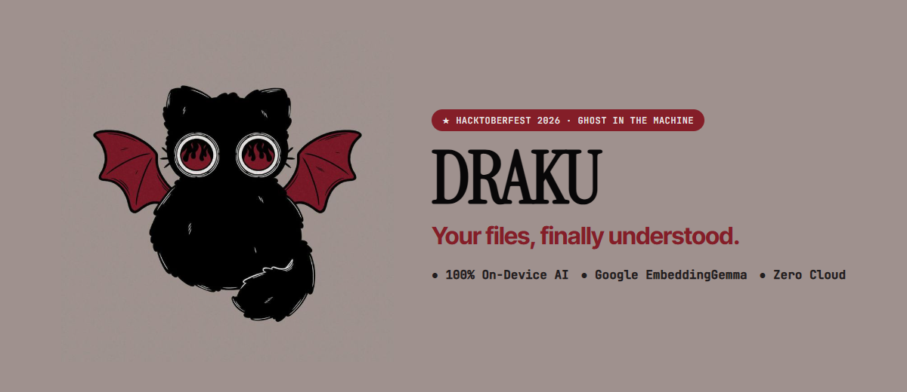
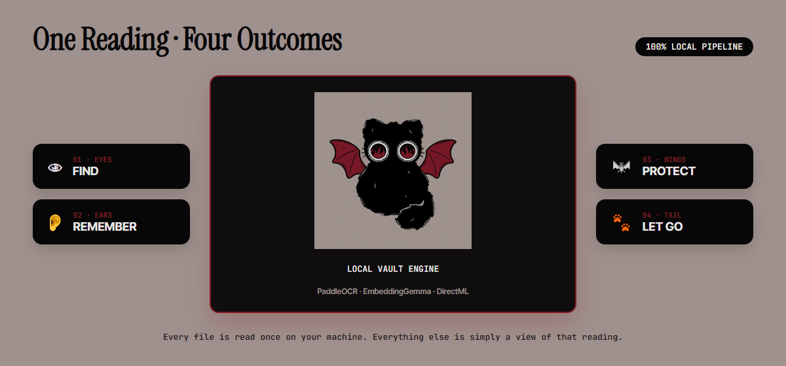
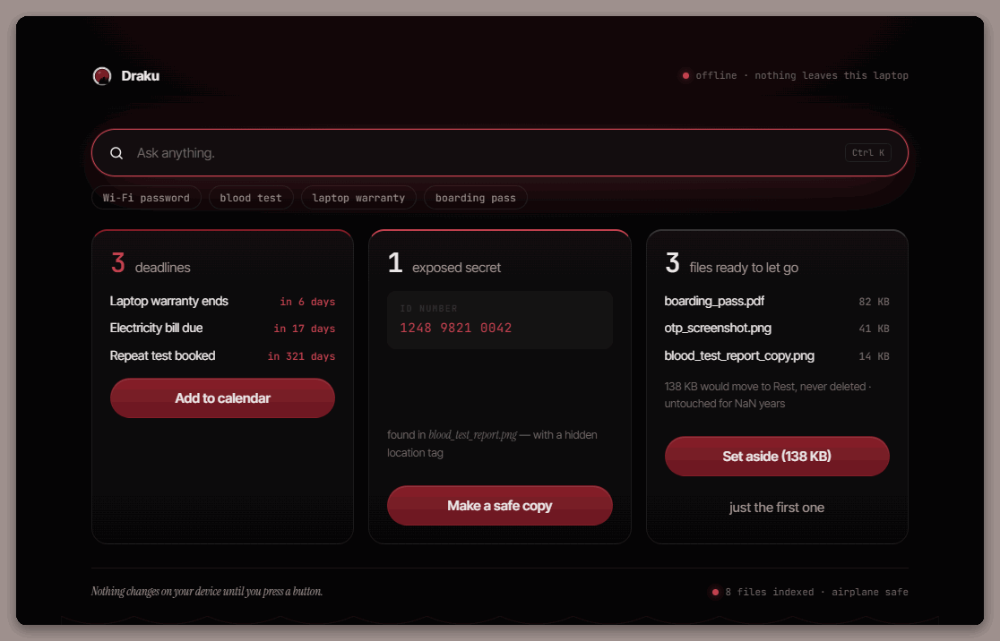
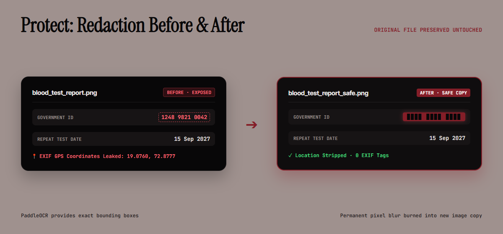
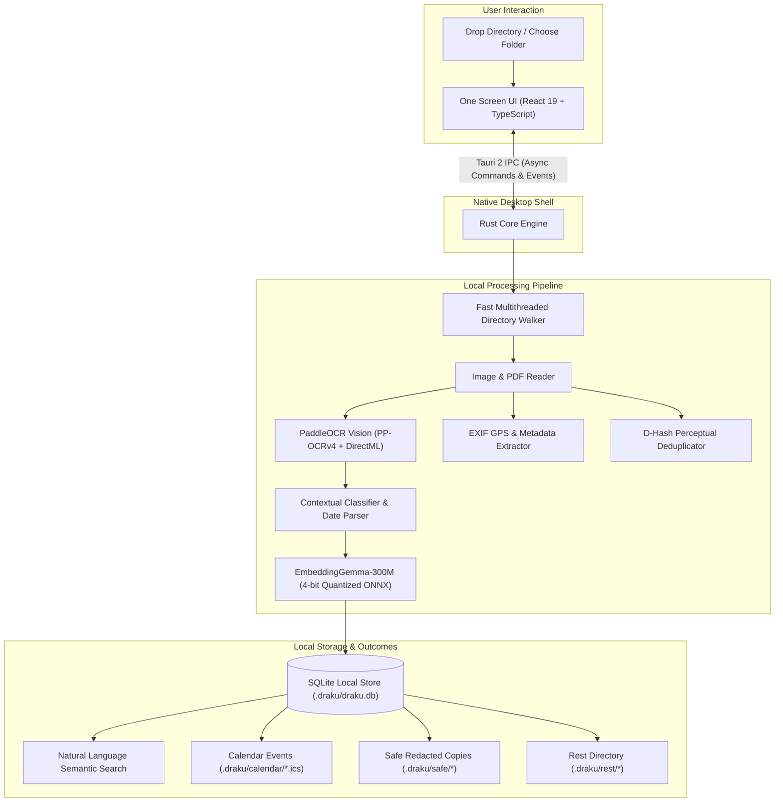

# Draku

<div align="center">



<br/>

**Your files, finally understood. 100% offline, on-device AI for your desktop.**

<br/>

[](https://github.com/0dvsh0/draku/actions/workflows/ci.yml)
[](https://github.com/0dvsh0/draku/actions/workflows/pages.yml)
[](https://github.com/0dvsh0/draku/releases/latest)
[](https://github.com/0dvsh0/draku/releases/latest)
[](https://github.com/0dvsh0/draku)
[](LICENSE)

<p align="center">
  <a href="https://0dvsh0.github.io/draku/"><strong>Explore Website</strong></a> •
  <a href="https://github.com/0dvsh0/draku/releases/latest"><strong>Download App</strong></a> •
  <a href="DEMO.md"><strong>60s Demo Guide</strong></a> •
  <a href="#-architecture--how-it-works"><strong>Architecture</strong></a> •
  <a href="#-building-from-source"><strong>Build from Source</strong></a>
</p>

</div>

---

## What is Draku?

Screenshots and photo scans are the most widely used personal notebook on earth. Yet to your operating system, they remain silent, unindexed grids of raw pixels: cryptic filenames like `IMG-20261011-WA0004.jpg`, `Screenshot_2026-09-14.png`, and `scan_final_v2.pdf`.

Inside those pixels live four categories of digital residue:
1. **The Trapped Deadline:** A warranty receipt expiring next week, a lab test due for follow-up, or a bill due tonight—invisible to your calendar app.
2. **The Exposed Secret:** A national ID card, bank document, or Wi-Fi password sitting unredacted where any app with folder permissions can inspect it.
3. **The Hidden Location:** Invisible EXIF GPS coordinates silently attached to photos you are about to email or share.
4. **The Dead Clutter:** One-time passwords from months ago, expired boarding passes, and blurry duplicate scans wasting storage.

**Meet Draku**—a fluffy black cat with crimson bat wings and eyes full of black flames. **He sees everything on your device, and he tells no one.**

Draku is a free, open-source desktop application that scans a folder **once** using local **PaddleOCR** and Google's open-weight **EmbeddingGemma-300M**, turning that single reading into four tangible outcomes without a single byte ever touching a remote server.

<div align="center">
  
</div>

---

## One Reading, Four Outcomes

Every file in a scanned folder produces a structured, inspectable local reading:

```json
{
  "name":     "2026-10-11 Dr Patel blood test prescription",
  "category": "medical / prescription",
  "dates":    [{ "refill_by": "2026-11-10" }],
  "private":  ["patient_id", "gps"],
  "dead":     0.04,
  "network":  null
}
```

From this single reading, Draku powers four distinct outcomes:

### 1. 🔍 Find — Natural Renaming & Semantic Search
Local OCR reads text directly from image pixels. A rule-based classifier renames obscure files into human-readable descriptions (e.g. `IMG-20261011-WA0004.jpg` becomes `2026-10-11 Dr Patel blood test prescription.jpg`). **EmbeddingGemma-300M** embeds the semantic context into high-dimensional vectors. You can search by intent in plain English: typing `"internet password"` surfaces your router credentials sticker with zero keyword overlap.

<div align="center">
  
</div>

### 2. 📅 Remember — Proximity Dates to Calendar
Draku extracts dates alongside their surrounding linguistic context. It understands the difference between *"Warranty ends in 6 days"* (an actionable deadline) and *"Purchase date 2024-05-10"* (historical context). With one click, Draku generates a clean `.ics` calendar reminder that opens directly in your default calendar application.

<div align="center">
  
</div>

### 3. 🛡️ Protect — Local Redaction & GPS Stripping
Detects exposed national identification numbers, credit card digits, plaintext credentials, and hidden EXIF GPS tags. Clicking **"Make a safe copy"** burns an irreversible pixelation blur into a safe copy located in `.draku/safe/` and strips all geolocation metadata. **Your original file remains untouched.**

<div align="center">
  
  <br/><br/>
  
</div>

### 4. 🕊️ Let Go — Transparent Scoring & Rest Folder
Draku computes a transparent, explainable "dead file" score based on file age, document category, expired deadlines, perceptual duplicate distance (`dhash`), and image blur. Clicking **"Set aside"** moves obsolete files into `.draku/rest/`.

> **There is no delete command anywhere in the codebase.** Your files are never destroyed; they rest in a recoverable folder that only you can permanently empty.

<div align="center">
  
</div>

---

## The Five Guarantees

1. 🔒 **Zero Network & True Offline:** Bundled with local vision and embedding models. Disconnect your Wi-Fi or turn on Airplane Mode—every feature continues to work with zero degradation.
2. 🗄️ **Zero Deletion:** Draku never deletes files. It safely archives them into a dedicated rest directory with immediate one-click restore.
3. 👆 **Suggest → Confirm Protocol:** The first click previews what will happen; the second click confirms. Every operation offers an immediate Undo toast. Nothing on your disk changes silently.
4. 🎁 **Free & Open Source:** Licensed under MIT. No premium subscriptions, no accounts, no telemetry, no API keys.
5. 🪟 **Zero Settings Screen:** Drop a folder to reveal one search bar and three actionable cards. If a feature requires a settings panel to be usable, it is not ready.

---

## Download & Installation

Visit the [GitHub Releases page](https://github.com/0dvsh0/draku/releases/latest) to download the latest release for Windows 10/11:

| Package | File | Size | Description |
|:---|:---|:---|:---|
| **Standalone Portable** | [`draku.exe`](https://github.com/0dvsh0/draku/releases/latest/download/draku.exe) | **~45 MiB** | Single portable executable. No installer needed. Downloads models on first scan. |
| **Offline NSIS Installer** | [`Draku_0.1.0_x64-setup.exe`](https://github.com/0dvsh0/draku/releases/latest/download/Draku_0.1.0_x64-setup.exe) | **~182 MiB** | Full installer pre-bundled with ONNX models and DirectML for complete offline first run. |

### Cryptographic Checksums (v0.1.0)

| File | SHA-256 Checksum |
|:---|:---|
| `Draku_0.1.0_x64-setup.exe` | `19473E9A5AEC88BDE82DF50CD697E7A9450A0B0EA88B49E65B57F89843E52791` |
| `draku.exe` | `6EA45C1D852DE604ADF390D220D0F5E4DA5840DD736736AB6DDC50F340CD95C8` |

---

## 🏗️ Architecture & How It Works



### Technology Stack

- **Desktop Framework:** [Tauri 2.0](https://v2.tauri.app/) (Rust backend + WebView2 frontend shell)
- **Frontend UI:** React 19, TypeScript, Vite, custom mascot design tokens (`tokens.css`)
- **Local Vision / OCR:** Vendored PaddleOCR ONNX Runtime (PP-OCRv4 detection, direction classification, character recognition) with DirectML GPU acceleration
- **Semantic Embeddings:** Google DeepMind [EmbeddingGemma-300M](https://ai.google.dev/gemma) (4-bit quantized ONNX) loaded in memory via `fastembed` and ONNX Runtime
- **Database:** Local SQLite database with Write-Ahead Logging (WAL) stored directly inside `.draku/draku.db`
- **Safety & Cryptography:** `dhash` perceptual duplicate hashing, EXIF parser, native irreversible pixel blur

---

## 🛠️ Building from Source

### Prerequisites

- **Rust:** 1.85 or newer (`rustup default stable`)
- **Node.js:** 20+ with `npm`
- **Operating System:** Windows 10 or 11 with Microsoft Edge WebView2 installed
- **C++ Build Tools:** Visual Studio C++ Build Tools (for native ONNX linking)

### 1. Clone & Install Dependencies

```pwsh
git clone https://github.com/0dvsh0/draku.git
cd draku/app
npm install
```

### 2. Fetch Embedding Model Weights (One-Time)

Release builds bundle the ~219 MB EmbeddingGemma model for complete out-of-the-box offline operation:

```pwsh
node scripts/fetch-model.mjs
```

*(Note: In dev mode, if this step is skipped, the app will download weights upon the first scan.)*

### 3. Launch Development Server

```pwsh
npm run tauri dev
```

### 4. Build Production Releases

To create an optimized release build and package the NSIS installer:

```pwsh
npm run tauri:release
```

The resulting setup installer is placed in `app/src-tauri/target/release/bundle/nsis/`.

---

## 🧪 Testing Suite

Draku maintains rigorous automated test suites across both frontend and native layers:

```pwsh
cd app

# Frontend unit tests for human formatting utilities (Vitest)
npm test

# Strict TypeScript type verification
npm run check

# Verify installer packaging integrity (silent test install)
npm run smoke:installer

# Rust Native Core test suites
cd src-tauri

# Full OCR & embedding pipeline (42 passing tests)
cargo test --features ocr

# Light build without PaddleOCR (41 passing tests)
cargo test --no-default-features
```

---

## 📁 Repository Structure

```
draku/
├── .github/
│   └── workflows/        # CI automation (lint, typecheck, cargo test, NSIS smoke test)
├── app/                  # Desktop application (Tauri 2)
│   ├── src/              # One Screen UI (React 19 + TypeScript + tokens.css)
│   ├── scripts/          # Model downloaders and installer validation scripts
│   └── src-tauri/        # Rust native backend
│       ├── src/          # Scan walker, OCR pipeline, FastEmbed, SQLite store, Actions
│       └── vendor/       # Vendored PaddleOCR Rust bindings with DirectML patches
├── site/                 # Project landing page (HTML5 / CSS3 / WebGL ember canvas)
├── CONTEXT.md            # Architecture specification & development roadmap
├── DEMO.md               # 60-second airplane-mode walk-through guide
├── LICENSE               # MIT License
└── THIRD_PARTY_NOTICES.md# Model licenses and third-party acknowledgements
```

---

## 🔐 Security & Threat Model

- **No Remote Telemetry:** The compiled binary opens zero outbound sockets for user data or telemetry.
- **Isolated State:** Scanned indices and metadata are saved strictly inside a `.draku/` directory inside the targeted folder.
- **True Redaction:** "Make a safe copy" generates a brand-new raster image where pixels in the bounding box are permanently averaged and destroyed, stripping all metadata. It is never a simple cosmetic overlay.
- **Non-Destructive Defaults:** Originals are never rewritten, replaced, or deleted.

---

## 📜 Models & Licenses

- **EmbeddingGemma-300M:** Google DeepMind, open weights under the [Gemma Terms of Use](https://ai.google.dev/gemma/terms). ONNX conversion provided by `onnx-community`.
- **PaddleOCR Models:** Apache-2.0 license.
- **FastEmbed & ONNX Runtime:** Apache-2.0 / MIT.
- **Draku Codebase:** Released under the [MIT License](LICENSE).

For full third-party notices and licenses, see [THIRD_PARTY_NOTICES.md](THIRD_PARTY_NOTICES.md).

---

<div align="center">
  <sub>Built with care for private, local computing.</sub>
</div>
